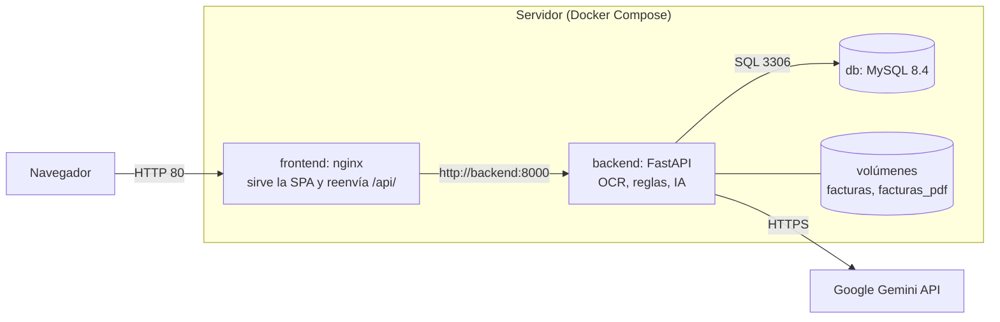
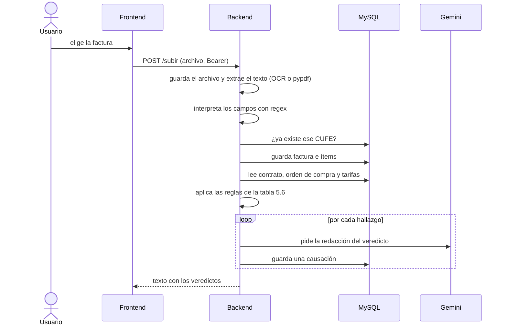
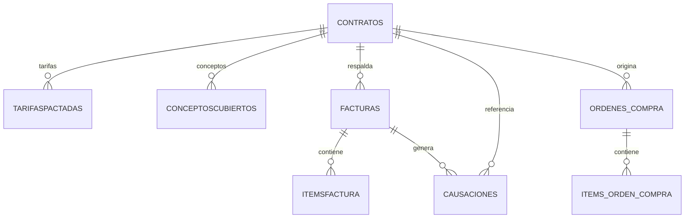
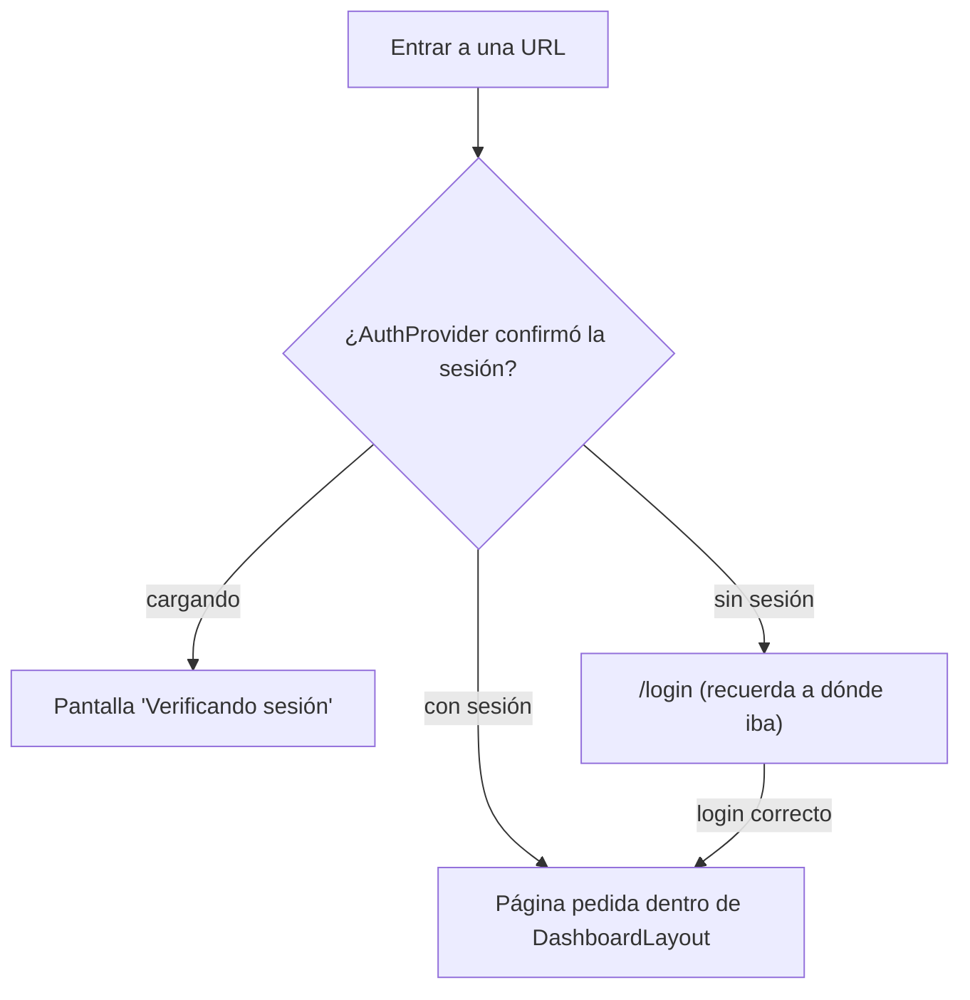

# Facto: manual técnico

| | |
|---|---|
| Proyecto | Facto (repositorio `hackaton-pysquad`) |
| Repositorio | https://github.com/tefvm1505/hackaton-pysquad |
| Rama revisada | `main` |
| Fecha de la revisión | 13 de noviembre de 2026 |
| Para quién es | Quien despliega, mantiene o amplía el sistema |

Este manual describe lo que hace el código hoy, no lo que se planeó. Donde algo no funciona o quedó a medias, está dicho en la sección 9. La sección 10 explica cómo se hizo la revisión y qué no se pudo probar.

## Contenido

1. [Qué es Facto](#1-qué-es-facto)
2. [Arquitectura](#2-arquitectura)
3. [Estructura del repositorio](#3-estructura-del-repositorio)
4. [Puesta en marcha](#4-puesta-en-marcha)
5. [Backend](#5-backend)
6. [Frontend](#6-frontend)
7. [Despliegue con Docker](#7-despliegue-con-docker)
8. [Seguridad](#8-seguridad)
9. [Limitaciones conocidas y deuda técnica](#9-limitaciones-conocidas-y-deuda-técnica)
10. [Cómo se hizo esta revisión](#10-cómo-se-hizo-esta-revisión)
11. [Guía para ampliar el sistema](#11-guía-para-ampliar-el-sistema)
12. [Solución de problemas](#12-solución-de-problemas)
13. [Glosario](#13-glosario)

---

## 1. Qué es Facto

Facto es un backoffice para auditar facturas electrónicas colombianas antes de causarlas. Una persona sube una factura (PDF o imagen). El sistema:

1. Extrae los datos del documento (OCR con Tesseract para imágenes, lectura de texto para PDF, y expresiones regulares para interpretarlos).
2. Guarda la factura y sus ítems.
3. La compara contra su **orden de compra** y su **contrato** (validación de tres vías).
4. Registra una **causación** por cada hallazgo, o una sola "validada" si no hay ninguno. Cada causación lleva una explicación redactada por Google Gemini.
5. Muestra el resultado en pantalla y lo deja consultable.

Además hay un asistente de chat que responde preguntas sobre contratos, facturas, órdenes de compra y causaciones. Para responder, el backend le pasa a Gemini el contenido de esas tablas.

**Qué no hace:** no crea contratos, tarifas ni órdenes de compra (se cargan directamente en la base de datos), no aprueba ni rechaza facturas a mano (el veredicto lo calcula el backend) y no tiene roles diferenciados.

---

## 2. Arquitectura



| Contenedor | Imagen base | Puerto | Qué hace |
|---|---|---|---|
| `db` | `mysql:8.4` | 3306, solo interno | Base de datos. Datos en el volumen `mysql_data`. |
| `backend` | `python:3.13-slim` + Tesseract | 8000, solo interno | API FastAPI. Aplica las migraciones al arrancar. |
| `frontend` | `nginx:1.27-alpine` | **80, único publicado** | Sirve la aplicación compilada y reenvía `/api/*` al backend. |

El navegador solo habla con nginx. La API llega por el mismo dominio bajo `/api/`, y nginx quita ese prefijo antes de reenviar (`/api/facturas` llega al backend como `/facturas`). El backend no usa prefijo `/api`.

---

## 3. Estructura del repositorio

```
.
├── .env.example            Variables de Docker Compose (copiar a .env)
├── docker-compose.yml      db + backend + frontend
├── docs/                   Esta documentación
├── backend/
│   ├── main.py             App FastAPI, CORS y registro de rutas
│   ├── config.py           Settings (Pydantic) leídas del entorno
│   ├── config_db.py        Engine, SessionLocal, get_db y Base
│   ├── crear_admin.py      Script para crear el primer usuario
│   ├── datos_prueba.sql    Datos de ejemplo (solo INSERT)
│   ├── Dockerfile
│   ├── requirements.txt
│   ├── alembic.ini
│   ├── alembic/            env.py y versions/ (10 migraciones)
│   ├── models/             Tablas SQLAlchemy
│   ├── schemas/            Cuerpos de petición (Pydantic)
│   ├── routes/             Endpoints
│   ├── services/           Lógica: usuarios/JWT, extracción de facturas, IA
│   ├── facturas/           Imágenes subidas (volumen en Docker)
│   └── facturas_pdf/       PDF subidos (volumen en Docker)
└── frontend/
    ├── Dockerfile          Compila con Node 22 y sirve con nginx
    ├── nginx.conf
    ├── vite.config.js
    ├── package.json
    ├── README.md           Notas del frontend (parte desactualizada, ver 9.3)
    └── src/                Ver sección 6.2
```

---

## 4. Puesta en marcha

### 4.1 Requisitos

| Para | Necesitas |
|---|---|
| Servidor (recomendado) | Docker y Docker Compose v2. Una clave de la API de Gemini. |
| Desarrollo local | Python 3.13, Node 22, MySQL 8, Tesseract OCR con el idioma español (`spa`). |

### 4.2 Variables de entorno

**Docker Compose** (archivo `.env` en la raíz, copiado de `.env.example`; no se sube a git):

| Variable | Obligatoria | Para qué |
|---|---|---|
| `DB_NAME` | Sí | Nombre de la base de datos. |
| `DB_USER` | Sí | Usuario de la aplicación en MySQL. |
| `DB_PASSWORD` | Sí | Clave de ese usuario. |
| `MYSQL_ROOT_PASSWORD` | Sí | Clave de `root` en MySQL. |
| `SECRET_KEY` | Sí | Firma de los tokens JWT. Generar una larga y aleatoria. |
| `ALGORITHM` | No (por defecto `HS256`) | Algoritmo del JWT. |
| `API_KEY` | Sí | Clave de la API de Google Gemini. |

Si falta una obligatoria, `docker compose` se detiene con un mensaje del tipo `Falta SECRET_KEY en .env`.

Para generar `SECRET_KEY` en cualquier sistema con Python:

```
python -c "import secrets; print(secrets.token_hex(32))"
```

**Backend en local** (archivo `backend/.env`; lo lee `config.py` desde la carpeta donde se ejecuta):

| Variable | Valor típico | Nota |
|---|---|---|
| `DB_HOST` | `localhost` | Sin valor por defecto útil. |
| `DB_PORT` | `3306` | |
| `DB_USER`, `DB_PASSWORD`, `DB_NAME` | los de tu MySQL | |
| `SECRET_KEY` | cadena aleatoria | |
| `ALGORITHM` | `HS256` | **Obligatoria en local.** Su valor por defecto es vacío y con eso no se pueden firmar tokens. Docker la define sola. |
| `API_KEY` | clave de Gemini | |
| `TESSERACT_CMD` | `C:\Program Files\Tesseract-OCR\tesseract.exe` | Solo en Windows. Es la ruta por defecto si no se define. |

`config.py` también declara `ACCESS_TOKEN_EXPIRE_MINUTES` y `CORS_ORIGINS`, pero ninguna se usa (ver 9.3).

**Frontend** (se fija al compilar, no al arrancar):

| Variable | Dónde | Valor |
|---|---|---|
| `VITE_API_URL` | Docker: argumento de build en `frontend/Dockerfile` | `/api` (fijo; `docker-compose.yml` no lo cambia) |
| `VITE_API_URL` | Local: `frontend/.env.local` | `http://localhost:8000` (ver 9.1) |

### 4.3 Despliegue con Docker

```
cp .env.example .env          # completar los valores
docker compose up -d --build
```

Al arrancar, el backend ejecuta `alembic upgrade head` y levanta la API. La aplicación queda en `http://<servidor>/`.

**Crear el primer usuario.** El endpoint `/crear-usuario` está comentado a propósito, así que en una base nueva se usa el script (pide cédula, nombres, apellidos, teléfono y contraseña dos veces):

```
docker compose exec backend python crear_admin.py
```

**Cargar datos de prueba (opcional).** `backend/datos_prueba.sql` solo trae `INSERT`, así que se carga después de las migraciones. Para evitar problemas de codificación en PowerShell, copiar el archivo dentro del contenedor y ejecutarlo allí:

```
docker compose cp backend/datos_prueba.sql db:/tmp/datos_prueba.sql
docker compose exec db sh -c 'mysql -uroot -p"$MYSQL_ROOT_PASSWORD" "$MYSQL_DATABASE" < /tmp/datos_prueba.sql'
```

El archivo carga contratos, conceptos cubiertos, tarifas, 4 facturas con sus ítems y 4 causaciones. **No trae órdenes de compra ni usuarios** (ver 9.2, punto 11).

### 4.4 Desarrollo local

Backend:

```
cd backend
python -m venv venv
venv\Scripts\activate            # en Linux o macOS: source venv/bin/activate
pip install -r requirements.txt
# crear backend/.env (ver 4.2) y tener MySQL con la base creada
alembic upgrade head
uvicorn main:app --reload        # http://localhost:8000  (documentación interactiva en /docs)
```

Frontend:

```
cd frontend
npm install
# crear frontend/.env.local con: VITE_API_URL=http://localhost:8000
npm run dev                      # http://localhost:5173
npm run lint
npm run build
```

En local el navegador llama al backend directamente, y el backend acepta cualquier origen (ver 8.2).

### 4.5 Operación diaria

| Tarea | Comando |
|---|---|
| Ver el estado | `docker compose ps` |
| Ver logs del backend | `docker compose logs -f backend` |
| Actualizar a la última versión | `git pull` y luego `docker compose up -d --build` |
| Reiniciar un servicio | `docker compose restart backend` |
| Respaldar la base | `docker compose exec db sh -c 'mysqldump -uroot -p"$MYSQL_ROOT_PASSWORD" "$MYSQL_DATABASE" > /tmp/backup.sql'` y luego `docker compose cp db:/tmp/backup.sql ./backup.sql` |
| Respaldar las facturas subidas | `docker compose cp backend:/app/facturas ./respaldo-facturas` y lo mismo con `facturas_pdf` |

> **Cuidado:** `docker compose down -v` borra los volúmenes, es decir, la base de datos y todas las facturas subidas. `docker compose down` sin `-v` es seguro.

---

## 5. Backend

### 5.1 Tecnologías

Python 3.13 · FastAPI · SQLAlchemy 2 con PyMySQL · Alembic · Pydantic Settings · PyJWT · passlib con bcrypt · pytesseract y Pillow (OCR) · pypdf · `google-genai` (Gemini).

### 5.2 Módulos

| Ruta | Contenido |
|---|---|
| `main.py` | Crea la app, activa CORS y registra los cuatro routers. |
| `config.py` | Clase `Settings`; construye la URL `mysql+pymysql://...`. |
| `config_db.py` | `engine`, `SessionLocal`, `get_db()` (una sesión por petición) y `Base`. |
| `routes/usuarios.py` | `POST /login`. |
| `routes/facturas.py` | Carga y validación de facturas, y consultas de facturas, contratos y causaciones. |
| `routes/ordenescompra.py` | Consulta de órdenes de compra. |
| `routes/chatIA.py` | Chat con el asistente. |
| `services/usuarios.py` | Hash de contraseñas, creación y verificación de JWT, dependencia `verificar_token`. |
| `services/facturas.py` | OCR, lectura de PDF, interpretación con regex, consultas. |
| `services/ia.py` | Las dos llamadas a Gemini. |
| `models/` | `usuarios`, `contratos` (con tarifas y conceptos), `facturas` (con ítems), `causacion`, `ordenescompra` (con ítems). |
| `schemas/` | `CrearUsuario`, `LoginUsuario`, `Chatear`. |

### 5.3 Autenticación

1. `POST /login` recibe `{ "cedula": 123, "contraseña": "..." }`.
2. Busca el usuario por cédula y compara la contraseña con el hash bcrypt.
3. Devuelve el **token JWT como cadena JSON** (no un objeto).
4. El cliente lo envía en `Authorization: Bearer <token>`.

El token se firma con `SECRET_KEY` y `ALGORITHM`. Contiene `sub` (la cédula), `rol`, `iat` y `exp`. **Dura 60 minutos**, valor escrito en el código de `verificariniciosesion`. No hay renovación ni cierre de sesión en el servidor: cerrar sesión solo borra el token del navegador.

Todos los endpoints exigen token salvo `/login` y `/heald`. La dependencia `verificar_token` valida la firma y la vigencia, pero **no revisa el rol**: cualquier usuario con token válido puede usar todo. Con token vencido o inválido responde `401`. Sin la cabecera `Authorization`, FastAPI responde `401` o `403` según su versión.

Los usuarios se crean con `crear_admin.py`, que usa `crearusuarios()`. Esa función siempre asigna el rol `admin`.

### 5.4 Endpoints

| Método | Ruta | Token | Qué hace |
|---|---|---|---|
| GET | `/heald` | No | Responde `"servidor activo"`. El nombre lleva esa errata. |
| POST | `/login` | No | Devuelve el JWT. `404` si el usuario no existe, `401` si la contraseña es incorrecta. |
| POST | `/subir` | Sí | Recibe un archivo (multipart, campo `archivo`), lo procesa y devuelve el texto del veredicto. Ver 5.5. |
| GET | `/facturas` | Sí | Todas las facturas. Cada una trae `estado`: el de su **primera** causación, o `"sin causación"`. |
| GET | `/causaciones` | Sí | Todas las causaciones. |
| GET | `/causaciones/factura/{cufe}` | Sí | Causaciones de una factura, por id ascendente. `404` si la factura no existe. |
| GET | `/contratos` | Sí | Todos los contratos. |
| GET | `/ordenes-compra` | Sí | Todas las órdenes (más recientes primero), con `cantidad_items`. |
| GET | `/ordenes-compra/{id}` | Sí | Una orden y sus ítems. El `id` puede ser el numérico o el número de orden. |
| GET | `/ordenes-compra/{id}/items` | Sí | Misma respuesta que la anterior. |
| POST | `/chatIA` | Sí | Cuerpo `{ "pregunta": "...", "cedula": 123 }`. Devuelve el texto de la respuesta. Ver 5.7. |

### 5.5 Carga y validación de una factura



**Tipo de archivo.** Se decide por extensión o tipo MIME declarado por el cliente:

| Tipo | Se guarda en | Lectura |
|---|---|---|
| Imagen (`.png .jpg .jpeg .webp .bmp .tiff`) | `facturas/factura_<uuid>.png` (siempre con extensión `.png`) | Tesseract, idioma `spa` |
| `.pdf .docx .doc .txt` | `facturas_pdf/factura_<uuid>.pdf` | `pypdf` (solo funciona con PDF reales) |
| Otro | no se guarda | Responde `200` con el texto `"formato desconocido"` |

**Formato que esperan las expresiones regulares.** La extracción no usa IA: depende de que el documento tenga estas etiquetas. Si falta alguna, la respuesta es `400` con `No se pudieron extraer todos los datos de la factura. Campos faltantes: ...`.

| Dato | Cómo debe aparecer en el texto |
|---|---|
| Emisor | Primera línea no vacía |
| NIT emisor | `NIT: 900.123.456-8` |
| Número de factura | `FACTURA ELECTRÓNICA DE VENTA No. FE-4501` |
| Fechas | `Fecha de emisión: 2026-10-12` y `Fecha de vencimiento: 2026-11-11` |
| Cliente y NIT | `Cliente: <nombre> NIT cliente: <nit>` |
| Orden de compra, moneda, contrato | `Orden de compra: OC-1003`, `Moneda: COP`, `Contrato: CT-01` |
| Totales | `Subtotal $...`, `IVA 19% $...`, `TOTAL A PAGAR $...` |
| CUFE | `CUFE: <hexadecimal>` |
| Ítems | Imagen: una línea `descripción cantidad $precio $total`. PDF: cuatro líneas seguidas (descripción, cantidad, `$precio`, `$total`). |

Campos obligatorios: emisor, nit_emisor, numero_factura, fecha_emision, fecha_vencimiento, cliente, nit_cliente, orden_compra, moneda, contrato, subtotal, iva, total_pagar, cufe y al menos un ítem.

**Montos.** `limpiar_valor` borra todo lo que no sea un dígito. `$14.280.000` queda `14280000`, pero `$14.280.000,00` queda `1428000000`. Los montos deben venir sin decimales (ver 9.2, punto 1).

**Factura duplicada.** Si el CUFE ya existe no se guarda nada ni se crea causación. La respuesta es un texto de Gemini explicando el rechazo.

### 5.6 Reglas de validación (tres vías)

Todas se evalúan en `buscarcontrato()` (`routes/facturas.py`). Cada hallazgo genera una causación con el estado indicado.

| # | Regla | Estado |
|---|---|---|
| 1 | La orden de compra de la factura no existe (se busca por número de orden o por id). | `rechazada` |
| 2 | La orden pertenece a un contrato distinto del que declara la factura. | `rechazada` |
| 3 | El NIT del contrato no coincide con el NIT del emisor de la factura. | `rechazada` |
| 4 | El NIT de la orden no coincide con el de la factura, o con el del contrato. | `rechazada` |
| 5 | El IVA de la factura no es el 19% del subtotal. | `con errores` |
| 6 | El subtotal o el IVA de la factura no coincide con los de la orden. | `con errores` |
| 7 | Un ítem de la factura no está en las tarifas del contrato. | `con errores` |
| 8 | El precio unitario de un ítem supera el máximo pactado en el contrato. | `requiere revision` |
| 9 | Un ítem no existe en la orden, o su precio o cantidad difiere de la orden. | `con errores` |
| 10 | Un ítem de la orden no aparece en la factura. | `con errores` |
| 11 | El total de la factura no coincide con el total de la orden. | `rechazada` |
| 12 | Contrato `acumulado`: la suma de facturas ya `validada` más esta supera `valor_total`. | `rechazada` |
| 13 | Otras frecuencias con `valor_periodo`: el total de la factura, o el de la orden, es distinto del valor del período. | `rechazada` |
| 14 | Ninguna de las anteriores. | `validada` |

Detalles que conviene conocer:

- Los NIT se comparan quitando solo los puntos. `900123456-8` y `900123456` no son iguales.
- Los ítems se emparejan por descripción exacta, sin distinguir mayúsculas ni espacios en los extremos.
- Hay **una llamada a Gemini y una causación por hallazgo**. Una factura con muchos errores tarda más. nginx corta a los 180 segundos.
- Al crear cada causación se actualiza la orden de compra: `APROBADA` si el estado es `validada` o `aprobada`, `CANCELADA` en cualquier otro caso. Con varios hallazgos queda el efecto del último.
- En el listado de facturas el estado visible es el de la primera causación.
- Si el contrato que declara la factura no existe, al guardar la factura falla la clave foránea y la petición termina en error 500. Es lo que indica el código; no se probó.

### 5.7 Inteligencia artificial

Se usa Google Gemini (`gemini-3.5-flash-lite`) con `temperature = 0.2`, en dos funciones de `services/ia.py`:

| Función | Uso | Entrada | Salida |
|---|---|---|---|
| `responder_pregunta` | Redactar el veredicto de cada hallazgo | Lista JSON con `descripcion` y `estado` | Texto con las etiquetas `Estado:` y `Explicación:`. Máx. 1000 tokens. |
| `consultar_analista_datos` | Chat | **Toda** la información de contratos, tarifas, facturas, ítems, causaciones y órdenes de compra, más la pregunta | Texto plano, sin Markdown ni listas. Máx. 8192 tokens. |

Los prompts exigen no usar emojis, Markdown ni viñetas y escribir los montos en dígitos. El chat no guarda historial: cada pregunta es independiente. El campo `cedula` del cuerpo de `/chatIA` no se usa para nada.

### 5.8 Modelo de datos



`facturas.orden_compra` es un texto con el número de la orden. **No es clave foránea**: la relación se resuelve en el código. `usuarios` no se relaciona con las demás tablas.

| Tabla | Columnas principales |
|---|---|
| `usuarios` | `cedula` (PK, entero), `nombres`, `apellidos`, `telefono`, `rol`, `contraseña` (hash bcrypt) |
| `contratos` | `id_contrato` (PK), `proveedor_id`, `proveedor_nit`, `objeto`, `vigencia_inicio`, `vigencia_fin`, `valor_total`, `valor_periodo` (puede ser nulo), `frecuencia` (`acumulado`, `mensual`, `trimestral`, `anual`), `centro_costo`, `estado` (por defecto `activo`) |
| `tarifaspactadas` | `id`, `concepto`, `valor_unitario_maximo`, `id_contrato` |
| `conceptoscubiertos` | `id`, `descripcion`, `id_contrato`. Ninguna regla la usa. |
| `facturas` | `cufe` (PK), `emisor`, `nit_emisor`, `numero_factura`, `fecha_emision`, `fecha_vencimiento`, `cliente`, `nit_cliente`, `orden_compra`, `moneda`, `subtotal`, `iva`, `total_pagar`, `id_contrato` |
| `itemsfactura` | `id`, `descripcion`, `cantidad`, `precio_unitario`, `total`, `id_factura` (cufe) |
| `causaciones` | `id`, `id_factura`, `id_contrato`, `estado`, `sugerencia` (texto de la IA), `fecha_causacion` (automática) |
| `ordenes_compra` | `id`, `numero_orden` (único), `id_contrato`, `fecha_emision`, `fecha_esperada`, `estado` (`PENDIENTE`, `APROBADA`, `RECIBIDA`, `CANCELADA`), `nit_emisor`, `subtotal`, `iva`, `total` |
| `items_orden_compra` | `id`, `orden_id`, `descripcion`, `cantidad`, `precio_unitario`, `total` |

Los montos son `NUMERIC(15,2)`. Valores de `estado` en `causaciones`: `validada`, `rechazada`, `con errores`, `requiere revision`.

### 5.9 Migraciones (Alembic)

Hay una cadena lineal de 10 migraciones (del 10 al 13 de noviembre de 2026), desde `581913075f0a` (usuarios) hasta `6ee58fae3ab8` (órdenes de compra). `alembic/env.py` toma la URL de `Settings`, así que no se configura en `alembic.ini`.

Para cambiar el esquema:

1. Editar o crear el modelo en `models/`.
2. Si es un modelo nuevo, **importarlo en `alembic/env.py`**; si no, Alembic no lo ve.
3. `alembic revision --autogenerate -m "descripción"`.
4. **Revisar** el archivo generado en `alembic/versions/`.
5. `alembic upgrade head` (en Docker se aplica solo al reiniciar el backend).

---

## 6. Frontend

### 6.1 Tecnologías

Vite 8 · React 19 (JSX, sin TypeScript) · React Router 7 · Tailwind CSS 4 · shadcn/ui sobre Radix (`radix-ui`) · lucide-react · Sonner (avisos) · React Hook Form con Zod 4 · TanStack Table 9 · fuente Sora para la marca.

### 6.2 Estructura de `src/`

```
src/
├── main.jsx, App.jsx           Entrada y árbol de rutas
├── index.css                   Tema (colores, neumorfismo) y animaciones
├── config/routes.js            ROUTES (rutas) y NAV_ITEMS (menú lateral)
├── context/                    AuthContext: estado de la sesión
├── hooks/                      useAsync, useAuth, useEyeTracking, useKeyboardModality,
│                               useSlidingIndicator, useZeroGravityDrift
├── lib/                        api.js, format.js, semaphore.js, authSchemas.js,
│                               authRedirect.js, utils.js (y archivos de la
│                               versión anterior, ver 9.3)
├── pages/                      Una por pantalla (ver 6.4)
└── components/
    ├── ui/                     shadcn: botones, tablas, diálogos, tabs, etc.
    ├── layouts/                DashboardLayout, AuthLayout, ProtectedRoute, PublicOnlyRoute
    ├── assistant/              FloatingAssistant (burbuja y chat)
    ├── auth/                   InvoiceCharacters (facturas con ojos del login)
    ├── brand/                  BrandMark (nombre "Facto")
    ├── invoices/               Tabla, tarjeta, badge y acciones de facturas
    ├── contracts/              Resumen, tabla, tarjeta, badge y acciones de contratos
    └── review/                 CausacionesPanel
```

Las carpetas `components/upload/` y `components/exceptions/`, cinco archivos de `review/`, `ContractForm`, `ContractFinancialSummary`, `ObserveDialog`, el hook `useUploadQueue` y varios archivos `lib/mock*.js` son restos de una versión anterior con datos de ejemplo. Ninguna pantalla los usa (ver 9.3).

### 6.3 Sesión y rutas protegidas



- `login()` hace `POST /login`, guarda el token en `sessionStorage` (`facto:token`) y el usuario en `facto:user` (`{ id, rol }`, leídos del payload del token).
- `getSession()` revisa en el navegador que el token exista y no haya vencido (campo `exp`). La firma la valida el backend.
- Si cualquier petición hecha con `apiFetch` recibe `401`, `AuthProvider` descarta la sesión y la app vuelve al login.
- `ProtectedRoute` no monta ninguna página hasta confirmar la sesión. `PublicOnlyRoute` saca del login a quien ya entró.
- Tras iniciar sesión se vuelve a la página que se había pedido. `getSafeRedirect` solo acepta rutas internas, para evitar redirecciones a sitios externos.
- El token vive en `sessionStorage`: se pierde al cerrar la pestaña.

### 6.4 Pantallas

Rutas definidas en `config/routes.js` y declaradas en `App.jsx`. Fuera de `/login`, todas exigen sesión; cualquier ruta desconocida lleva a `/facturas`.

| Ruta | Página | Menú lateral |
|---|---|---|
| `/login` | `LoginPage` | No |
| `/facturas` | `InvoicesPage` | Facturas |
| `/facturas/:invoiceId/revision` | `InvoiceReviewPage` | |
| `/contratos` | `ContractsPage` | Contratos |
| `/contratos/:contractId/revision` | `ContractReviewPage` | |
| `/ordenes-compra` | `PurchaseOrdersPage` | Órdenes de compra |
| `/carga` | `UploadPage` | Carga de documentos |
| `/excepciones` | `ExceptionsPage` | Causaciones |

La ruta `/excepciones` conserva su nombre original, pero la pantalla muestra causaciones y el menú la llama "Causaciones".

**Login.** Formulario con cédula y contraseña, validado con Zod (la cédula solo admite dígitos). A la izquierda hay seis facturas ilustradas con ojos que siguen el puntero (`useEyeTracking`). **Los ojos se cierran** mientras el mouse está sobre la casilla de contraseña o el campo tiene el foco (`InvoiceCharacters` recibe la propiedad `eyesClosed`). Con "reducir movimiento" activado en el sistema, el cambio es instantáneo.

**Facturas.** Selector de pestañas (Todas, Verificada, Revisión, Rechazada, cada una con su contador), búsqueda por número, proveedor, NIT u orden de compra, y orden por columna. Desde 1024 px se muestra tabla; por debajo, tarjetas. El menú de cada fila permite abrir el detalle y copiar el número.

**Revisión de factura.** Solo lectura: datos de la factura, totales y panel de causaciones con la explicación de la IA y enlaces a la factura y al contrato. No hay botones de aprobar ni rechazar.

**Contratos.** Una tarjeta con el total y una más por cada `estado` distinto que haya en la base, pestañas por estado, filtro por tipo y búsqueda. La pantalla de revisión es solo lectura (información general, montos y vigencia).

**Órdenes de compra.** Resumen (total, aprobadas o recibidas, pendientes, canceladas y monto), pestañas por estado, búsqueda, y un diálogo de detalle que pide `/ordenes-compra/{id}/items`.

**Carga de documentos.** Zona de arrastre para un archivo (máximo 10 MB). Muestra vista previa (PDF en `iframe`, imagen en `img`) y un panel de IA con cuatro estados: reposo, procesando, listo y error. El resultado se muestra como texto. La petición va directo a `POST /subir` con `fetch`, no por `apiFetch`.

**Causaciones.** Resumen (total, validadas, con errores, rechazadas), selector neumórfico por estado, búsqueda y tarjetas. El filtro "Con errores" agrupa `con errores` y `requiere revision`. Cada tarjeta abre un diálogo con la sugerencia completa y enlaces a factura y contrato.

**Asistente flotante** (`FloatingAssistant`, solo dentro del panel, no en el login). Empieza como una burbuja líquida que flota con movimiento aleatorio de velocidad constante (`useZeroGravityDrift`). A los 3,5 s vuelve a su sitio durante 1,5 s y se estira en un rectángulo "¿Necesitas ayuda?". Al tocarla abre un chat conectado a `POST /chatIA`. Con el chat abierto la burbuja queda quieta en su lugar y muestra una X para cerrarlo. La conversación vive en memoria: se pierde al recargar.

### 6.5 Acceso a datos (`lib/api.js`)

| Función | Endpoint | Estado |
|---|---|---|
| `login`, `getSession`, `logout` | `/login` | Funciona |
| `apiFetch` | cualquiera | Funciona. Agrega el token y avisa si hay `401`. |
| `listInvoices`, `getInvoice` | `/facturas`, `/causaciones/factura/{cufe}` | Funciona |
| `listContracts`, `getContract` | `/contratos` | Funciona |
| `listCausaciones` | `/causaciones` | Funciona |
| `listPurchaseOrders`, `getPurchaseOrderItems` | `/ordenes-compra`, `/ordenes-compra/{id}/items` | Funciona |
| `approveInvoice`, `rejectInvoice`, `uploadInvoice`, `validateContract`, `observeContract` | Ninguno | **Rotas.** Ver 9.1. |

`getInvoice` y `getContract` no tienen endpoint propio: piden la lista completa y filtran en el navegador.

El backend usa nombres en español y el frontend nombres en inglés. La traducción se hace en `mapInvoice`, `mapContract` y `mapPurchaseOrder`. Ejemplo para facturas: `cufe` → `id`, `numero_factura` → `invoiceNumber`, `emisor` → `supplierName`, `total_pagar` → `total`, `iva` → `tax`.

**Estado de las facturas.** `mapBackendStatus` convierte el texto del backend en uno de los cinco estados del semáforo (`lib/semaphore.js`):

| `estado` del backend | Estado en pantalla | Color |
|---|---|---|
| `validada` | Validada | Verde |
| `aprobada` | Aprobada | Verde |
| `requiere revision`, `pendiente`, `sin causación` | Requiere revisión | Amarillo |
| `con errores`, `error` | Con errores | Rojo |
| `rechazada` | Rechazada | Rojo |

El color siempre va acompañado de texto. La regla estado → color vive solo en `lib/semaphore.js`.

### 6.6 Estilos

- Los colores son variables CSS en `index.css` (`--success`, `--warning`, `--danger` y sus versiones `-soft`), con tema claro y oscuro definidos.
- El neumorfismo tiene dos utilidades: `neu-inset` (hundido, la pista) y `neu-raised` (elevado, la pieza activa). Las usa `<TabsList variant="neumorphic">`, el selector de filtros de Facturas, Contratos, Órdenes de compra y Causaciones.
- La pieza deslizante del selector la coloca `useSlidingIndicator`. El anillo de foco lo muestra solo quien navega con teclado (`useKeyboardModality`).
- Las animaciones del asistente (`blob-morph`, `blob-morph-wide`, `jelly`) están en `index.css` y se apagan con "reducir movimiento".
- El nombre "Facto" se dibuja siempre con `BrandMark`, con la fuente Sora. El resto de la interfaz usa la fuente del sistema.
- Se usa `cn()` (`lib/utils.js`) para combinar clases.

### 6.7 Convenciones

Componentes propios en PascalCase; componentes de shadcn en minúsculas con guion; hooks como `useX.js`; páginas terminadas en `Page` con `export default`. Para enlaces y navegación se usa siempre `ROUTES`, nunca textos sueltos. Los datos asíncronos se cargan con `useAsync`, que no tiene caché ni reintentos.

Si se vuelve a ejecutar `npx shadcn add ... --overwrite`, `ui/tabs.jsx` perdería la variante `neumorphic`. El `frontend/README.md` explica cómo evitarlo.

---

## 7. Despliegue con Docker

**Backend** (`backend/Dockerfile`). Imagen `python:3.13-slim`. Instala Tesseract y su paquete de español, instala las dependencias en una capa aparte (para aprovechar la caché), crea un usuario sin privilegios (`app`) y arranca con:

```
alembic upgrade head && exec uvicorn main:app --host 0.0.0.0 --port 8000
```

**Frontend** (`frontend/Dockerfile`). Dos etapas: compila con Node 22 (`npm ci` y `npm run build`) y copia el resultado a nginx 1.27. La URL de la API se escribe en el JavaScript al compilar (`/api`).

**nginx** (`frontend/nginx.conf`):

| Regla | Efecto |
|---|---|
| `location /api/` | Reenvía a `http://backend:8000/`, quitando el prefijo. Agrega `Host`, `X-Real-IP`, `X-Forwarded-For` y `X-Forwarded-Proto`. Tiempos de lectura y envío de 180 s. |
| `client_max_body_size 12m` | Rechaza cargas mayores a 12 MB. |
| `location /assets/` | Caché de un año (los archivos llevan hash en el nombre). |
| `location /` | Cualquier ruta devuelve `index.html` (necesario para React Router), con `no-cache`. |
| Cabeceras | `X-Content-Type-Options: nosniff`, `X-Frame-Options: DENY`, `Referrer-Policy: strict-origin-when-cross-origin`. |

**Compose** (`docker-compose.yml`):

- `db` tiene `healthcheck`; el backend espera a que esté sano (`depends_on: service_healthy`). El backend y el frontend no tienen `healthcheck`.
- Todos los servicios tienen `restart: unless-stopped`.
- Volúmenes con nombre: `mysql_data`, `facturas_img` (montado en `/app/facturas`) y `facturas_pdf` (en `/app/facturas_pdf`).
- Solo el frontend publica puerto (`80:80`).
- **No hay HTTPS.** Para producción hay que ponerlo delante (balanceador, Caddy, Traefik u otro nginx con certificado).

Archivos `.dockerignore` en `backend/` y `frontend/` impiden que los `.env` entren en las imágenes.

---

## 8. Seguridad

### 8.1 Lo que ya está

- Contraseñas guardadas con bcrypt, nunca en claro.
- Todos los endpoints de datos exigen un JWT con firma y vencimiento.
- Consultas a la base con SQLAlchemy (parametrizadas).
- Secretos solo en `.env` (excluido de git y de las imágenes). `.env.example` no trae valores reales.
- La base de datos y el backend no se publican fuera de Docker.
- El backend corre sin privilegios de administrador dentro del contenedor.
- `/crear-usuario` está deshabilitado, para que nadie cree administradores desde fuera.
- nginx agrega las cabeceras de la sección 7.
- El frontend valida destinos de redirección y muestra el texto de la IA como texto (nunca como HTML).

### 8.2 Lo que falta

Ordenado de mayor a menor urgencia.

| # | Tema | Situación |
|---|---|---|
| 1 | HTTPS | Solo HTTP. El token y las contraseñas viajan sin cifrar si no hay un proxy con certificado delante. |
| 2 | Intentos de login | Sin límite ni bloqueo, así que se puede probar contraseñas sin freno. Además `/login` distingue "usuario no encontrado" (404) de "contraseña incorrecta" (401), lo que permite descubrir cédulas válidas. |
| 3 | Roles | Todos los usuarios creados son `admin` y ningún endpoint revisa el rol. |
| 4 | Datos enviados a un tercero | Cada pregunta del chat envía a Gemini el contenido completo de contratos, facturas, causaciones y órdenes. Conviene decidir si eso es aceptable con datos reales. |
| 5 | Texto de facturas no confiable | El texto leído de una factura entra en la base y luego en el contexto del chat. Un documento manipulado podría intentar influir en las respuestas de la IA. |
| 6 | Carga de archivos | El tamaño solo se limita en nginx (12 MB). El backend no revisa el contenido real del archivo (se fía de extensión y tipo MIME), no usa antivirus y no borra nunca los archivos guardados. |
| 7 | CORS | `main.py` acepta cualquier origen (`*`) con credenciales activadas. Con nginx de por medio todo es del mismo origen, así que hoy no afecta, pero conviene cerrarlo. |
| 8 | Token en el navegador | Está en `sessionStorage`; un ataque XSS podría leerlo. No hay forma de revocarlo antes de que venza. |
| 9 | Contraseñas débiles | `CrearUsuario` no impone ninguna regla de longitud ni complejidad. |
| 10 | Cabeceras | Falta `Content-Security-Policy` y `Strict-Transport-Security`. |

---

## 9. Limitaciones conocidas y deuda técnica

Hallazgos de la revisión del código. Los marcados con (*) se deducen de leer el código y no se probaron en ejecución. En la sección 12 también se usa esa marca.

### 9.1 Errores que ya afectan o afectarán

| # | Qué pasa | Dónde | Impacto |
|---|---|---|---|
| 1 | `frontend/.env.example` dice `VITE_API_URL=http://localhost:8000/api`, pero el backend no tiene prefijo `/api`. | `frontend/.env.example` | Quien copie ese archivo para desarrollo local verá 404 en todas las llamadas. Con Docker no afecta. |
| 2 | `approveInvoice`, `rejectInvoice`, `uploadInvoice`, `validateContract` y `observeContract` usan `assertMock`, `store` y `contractStore`, que ya no existen. | `lib/api.js` | Lanzan `ReferenceError` si alguien las llama. Hoy ninguna pantalla activa lo hace. |
| 3 | Los contratos con frecuencia `acumulado` se muestran como "Mensual". | `mapFrequency` en `lib/api.js` | Dato incorrecto en la pantalla de revisión del contrato. |
| 4 | "Contraparte" muestra `proveedor_id` (por ejemplo `P01`), no un nombre. El "Tipo" es siempre "Prestación de servicios" (valor fijo en el código). | `mapContract` en `lib/api.js` | Información engañosa en la tabla de contratos. |
| 5 | El intervalo de frases del panel "Analizando tu documento" se crea con `useState` en lugar de `useEffect`, así que nunca se limpia. | `ThinkingAnimation` en `UploadPage.jsx` | Fuga menor de temporizadores. |
| 6 | La carga usa `fetch` directo, sin pasar por `apiFetch`. | `UploadPage.jsx` | Si el token vence durante una carga, no se cierra la sesión; solo aparece el error. |
| 7 | La interfaz acepta XML, pero el backend no lo procesa. `.docx`, `.doc` y `.txt` se envían al lector de PDF y fallan (*). | `UploadPage.jsx`, `routes/facturas.py` | Un XML devuelve `200` con "formato desconocido" y la pantalla lo muestra como "Documento procesado exitosamente". |
| 8 | "Con errores" se pinta amarillo en el resumen y en el filtro de Causaciones, y rojo en las tarjetas. | `ExceptionsPage.jsx` | Inconsistencia visual. Falta decidir un color. |

### 9.2 Reglas y datos

| # | Tema | Detalle |
|---|---|---|
| 1 | Montos con decimales | `limpiar_valor` borra puntos y comas: `14.280.000,00` se guarda como `1428000000`. |
| 2 | IVA fijo | La regla compara siempre con el 19%. No admite otras tarifas ni exentos. |
| 3 | Vigencia del contrato | `vigencia_inicio` y `vigencia_fin` no se validan: se puede causar una factura de un contrato vencido. |
| 4 | Moneda | No se compara con la del contrato ni de la orden. |
| 5 | Descripciones | Los ítems deben coincidir exactamente (salvo mayúsculas y espacios en los extremos) con tarifa y orden. "Resma papel carta" y "Resma de papel carta" son ítems distintos. |
| 6 | Estado de la factura | Es el de su primera causación, aunque después se registren otras para la misma factura. |
| 7 | Estado de la orden | Lo fija el último hallazgo procesado. |
| 8 | Facturas repetidas | Subir otra vez el mismo CUFE no registra nada nuevo. |
| 9 | Contrato inexistente (*) | Genera error 500 por la clave foránea, no un mensaje claro. |
| 10 | Tablas sin pantalla ni endpoint de alta | Contratos, tarifas, conceptos cubiertos y órdenes de compra solo se pueden cargar directo en la base. `conceptoscubiertos` no se usa en ninguna regla. |
| 11 | Datos de prueba incompletos | `datos_prueba.sql` no trae órdenes de compra. Las facturas que incluye apuntan a `OC-1003`, `OC-1005`, `OC-1017` y `OC-1002`, que no existen. Una factura nueva se rechazará por regla 1 hasta cargar las órdenes. |
| 12 | Llamadas a IA en serie | Una por hallazgo. Con muchos hallazgos puede superar los 180 s de nginx. |

### 9.3 Código sin uso y documentación desactualizada

- **Componentes huérfanos** (nadie los importa): todo `components/upload/` y `components/exceptions/`; en `components/review/`, `ConfirmApproveDialog`, `ExtractedDataForm`, `InvoiceLinesTable`, `RejectDialog` y `ValidationFindings`; en `components/contracts/`, `ContractForm`, `ContractFinancialSummary` y `ObserveDialog`; y el hook `useUploadQueue`. `ExceptionDetailDialog` importa `resolveException` desde `lib/api.js`, que no existe; el proyecto compila porque nadie importa ese componente.
- **Datos de ejemplo dentro del JavaScript compilado.** `lib/api.js` sigue importando archivos `mock*.js`. Se comprobó buscando sus textos en el resultado de `npm run build`: aparecen las facturas y excepciones de ejemplo (por ejemplo `FE-10234` y `Distribuidora Andina S.A.S.`) y el usuario demo `demo@invoice.local`. La clave demo no aparece. `USE_MOCK` ya no se usa. Las funciones rotas de 9.1 #2 no llegan al compilado porque nadie las llama.
- **`frontend/README.md` está desactualizado.** Describe datos de ejemplo (`USE_MOCK = true`), una cuenta demo, un asistente sin conversación, endpoints propuestos como `/auth/login` o `/invoices/upload`, sesión por cookie, y pantallas de revisión con aprobar, rechazar y validar. Nada de eso corresponde al código actual. Sirve todavía para las secciones de decisiones de diseño (semáforo, selector neumórfico, `TanStack Table`, shadcn).
- **Backend:** `anthropic` y `openai` están en `requirements.txt` pero no se usan. `ia.py` importa `Usuarios` sin usarlo. `Settings.access_token_expire_minutes` y `Settings.cors_origins` no se leen.
- **Lint:** `npm run lint` termina sin errores y con 11 advertencias (variables e importaciones sin uso en `api.js`, `UploadPage.jsx` y `ContractsTable.jsx`, y tres avisos de recarga rápida en `ui/`). No detecta las referencias a `assertMock`, `store` y `contractStore`.
- **Sin pruebas automáticas.** El repositorio no tiene pruebas, ni de backend ni de frontend.

---

## 10. Cómo se hizo esta revisión

**Qué se hizo:** lectura de todo el backend, de la configuración de Docker y nginx, y de las páginas, hooks, `lib/` y componentes activos del frontend. También:

| Comprobación | Resultado |
|---|---|
| `npm run build` (frontend) | Compila sin errores |
| `npm run lint` | 0 errores, 11 advertencias |
| `python -m compileall` (backend) | Todos los archivos compilan |
| `docker compose config` con variables de ejemplo | El archivo es válido |
| Pantalla de login y de Causaciones en Chrome (sesiones anteriores) | Funcionan como se describe |

**Qué no se hizo:** no se levantaron los contenedores, no se ejecutaron las migraciones contra una base real, no se llamó a Gemini, no se probó el OCR con facturas reales y no se ejercitaron los endpoints. Lo que este manual dice sobre esas partes sale de leer el código.

---

## 11. Guía para ampliar el sistema

**Agregar un endpoint**
1. Crear la función en `routes/` y, si hace falta, el cuerpo en `schemas/`.
2. Proteger con `usuario: dict = Depends(verificar_token)`.
3. Si es un archivo de rutas nuevo, registrarlo con `app.include_router(...)` en `main.py`.
4. Para usarlo desde el frontend, agregar una función en `lib/api.js` con su mapeo de campos.

**Agregar una pantalla**
1. Crear `pages/NuevaPage.jsx` con `export default`.
2. Agregar la ruta en `config/routes.js` (`ROUTES`) y, si va en el menú, en `NAV_ITEMS`.
3. Declarar `<Route>` en `App.jsx` dentro del bloque protegido.
4. Cargar datos con `useAsync(funcion, [])`.

**Agregar o cambiar una regla de validación.** Editar `buscarcontrato()` en `routes/facturas.py`. Cada hallazgo es un diccionario `{ "descripcion": ..., "estado": ... }` agregado a `datosparalaia`; el resto (llamada a Gemini y causación) es automático. Si el estado es nuevo, agregarlo también a `STATUS_MAP` en `lib/api.js` y a `ESTADO_CONFIG` en `ExceptionsPage.jsx` y `CausacionesPanel.jsx`.

**Soportar otro formato de factura.** Las expresiones regulares están en `parsear_factura_electronica` (imágenes) y `parsear_factura_pdf` (PDF), en `services/facturas.py`. Los campos obligatorios están en `CAMPOS_REQUERIDOS`.

**Cambiar el modelo de IA o los textos.** Constantes `PROMPT_AGENTE`, `PROMPT_ANALISTA_DATOS` y el nombre del modelo en `services/ia.py`.

**Cambiar el esquema de la base.** Ver 5.9.

**Agregar un componente de shadcn.** `npx shadcn add <componente>`. Revisar el aviso de la sección 6.7 antes de usar `--overwrite`.

---

## 12. Solución de problemas

| Síntoma | Causa probable | Qué hacer |
|---|---|---|
| `docker compose` dice `Falta ... en .env` | Variable obligatoria sin definir | Completar `.env` (sección 4.2) |
| El backend se reinicia en bucle | Fallo en una migración o en la conexión a la base | `docker compose logs backend` |
| En local, todas las llamadas dan 404 | `VITE_API_URL` termina en `/api` | Usar `http://localhost:8000` (9.1 #1) |
| En local, el login falla con error 500 (*) | Falta `ALGORITHM` en `backend/.env`, y con valor vacío no se puede firmar el token | Agregar `ALGORITHM=HS256` |
| Todas las pantallas piden iniciar sesión de nuevo | Token vencido (60 min) o `SECRET_KEY` cambiada | Volver a entrar |
| Al subir: "No se pudieron extraer todos los datos... Campos faltantes: ..." | El documento no tiene el formato esperado o el OCR es de mala calidad | Revisar la tabla de 5.5; probar con un PDF original |
| La factura se rechaza con "No se encontró la orden de compra" | La orden no existe en la base | Cargarla en `ordenes_compra` e `items_orden_compra` (9.2 #11) |
| Error de Tesseract en Windows local | No está instalado o la ruta es otra | Instalarlo con el idioma español y definir `TESSERACT_CMD` |
| Las respuestas de IA fallan | `API_KEY` inválida, sin cuota o sin salida a internet | Revisar la clave y `docker compose logs backend` |
| Pantalla de carga sin respuesta y luego error de tiempo | La validación superó los 180 s (muchos hallazgos) | Reintentar; ver 9.2 #12 |
| `crear_admin.py` dice "el usuario ya existe" | Esa cédula ya está registrada | Usar otra cédula |

---

## 13. Glosario

| Término | Significado |
|---|---|
| **CUFE** | Código Único de Factura Electrónica. Identifica cada factura (clave primaria en `facturas`). |
| **NIT** | Número de Identificación Tributaria de una empresa. |
| **Orden de compra (OC)** | Documento que autoriza una compra a un proveedor, con ítems, precios y totales. |
| **Contrato** | Acuerdo con un proveedor: vigencia, valor total, frecuencia de cobro y tarifas máximas. |
| **Tarifa pactada** | Precio unitario máximo que el contrato permite para un concepto. |
| **Frecuencia** | Cómo se cobra un contrato: `mensual`, `trimestral`, `anual` (valor fijo por período) o `acumulado` (hasta un tope total). |
| **Validación de tres vías** | Comparar la factura con su orden de compra y con su contrato. |
| **Causación** | Registro contable del resultado de la revisión de una factura. Aquí guarda estado, explicación de la IA y fecha. |
| **Hallazgo** | Cada diferencia o error encontrado al validar. Genera una causación. |
| **Semáforo** | Colores verde, amarillo y rojo con que la interfaz resume el estado de una factura. |
| **OCR** | Reconocimiento de texto en imágenes (Tesseract). |
| **JWT** | Token firmado que prueba que el usuario inició sesión. |
